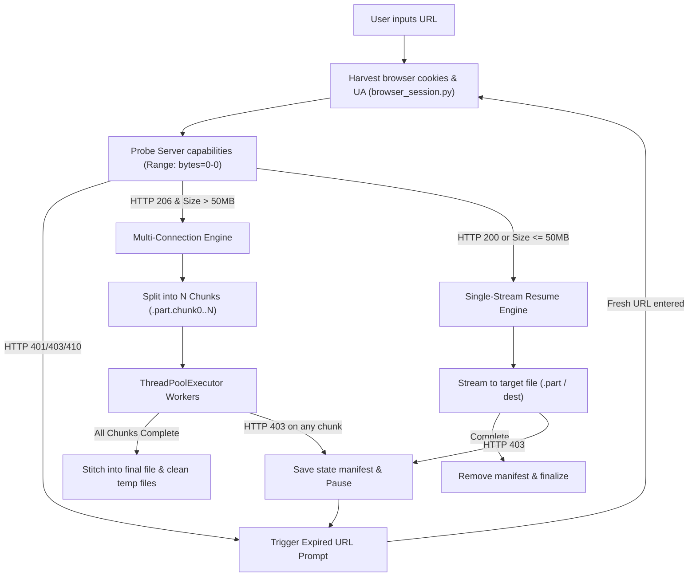

# Architecture & State Manifests

This document details the internal components, data flow, and state manifest structure of Smart Download Manager.

---

## 1. Codebase Structure

```
d:\Projects\my_smart_downloader\
├── __main__.py          # Entry point & CLI argument parser
├── cli.py               # Interactive terminal interface & menu loops
├── downloader.py        # Core download engine (probing, chunking, stitching)
├── state.py             # DownloadManifest, ChunkState, and file scanner
├── browser_session.py   # Cookie & User-Agent harvesting from Chrome/Edge/Firefox
├── test_download.py     # Comprehensive automated test suite
├── docs/                # User & developer documentation
│   ├── README.md
│   ├── quickstart.md
│   ├── usage_guide.md
│   ├── link_refreshing.md
│   ├── multi_connection.md
│   ├── cloudflare_bypass.md
│   └── architecture.md
├── requirements.txt     # Python dependencies
└── HANDOFF.md           # Developer handoff tracking
```

---

## 2. Download Execution Flow



---

## 3. State Manifest Format (`.meta.json`)

When a download starts or pauses, a metadata manifest is written alongside the target file (e.g., `downloads/archive.zip.meta.json`):

```json
{
  "target_file": "D:\\Projects\\my_smart_downloader\\downloads\\archive.zip",
  "original_url": "https://cdn.example.com/archive.zip?token=exp_123",
  "latest_url": "https://cdn.example.com/archive.zip?token=exp_123",
  "total_bytes": 104857600,
  "downloaded_bytes": 52428800,
  "supports_ranges": true,
  "is_chunked": true,
  "num_chunks": 4,
  "chunks": [
    {
      "index": 0,
      "start_byte": 0,
      "end_byte": 26214399,
      "temp_file": "D:\\Projects\\my_smart_downloader\\downloads\\archive.zip.part.chunk0",
      "completed": true,
      "downloaded_bytes": 26214400
    },
    {
      "index": 1,
      "start_byte": 26214400,
      "end_byte": 52428799,
      "temp_file": "D:\\Projects\\my_smart_downloader\\downloads\\archive.zip.part.chunk1",
      "completed": true,
      "downloaded_bytes": 26214400
    },
    {
      "index": 2,
      "start_byte": 52428800,
      "end_byte": 78643199,
      "temp_file": "D:\\Projects\\my_smart_downloader\\downloads\\archive.zip.part.chunk2",
      "completed": false,
      "downloaded_bytes": 0
    },
    {
      "index": 3,
      "start_byte": 78643200,
      "end_byte": 104857599,
      "temp_file": "D:\\Projects\\my_smart_downloader\\downloads\\archive.zip.part.chunk3",
      "completed": false,
      "downloaded_bytes": 0
    }
  ],
  "status": "paused_expired"
}
```

### Manifest Lifecycle
1. **Creation**: Initialized at download start.
2. **Persistence**: Updated atomically upon state changes or pause.
3. **Recovery**: Read by `find_unfinished_downloads()` to populate Option [2] in the CLI.
4. **Cleanup**: Removed automatically upon 100% successful download and file stitch.

